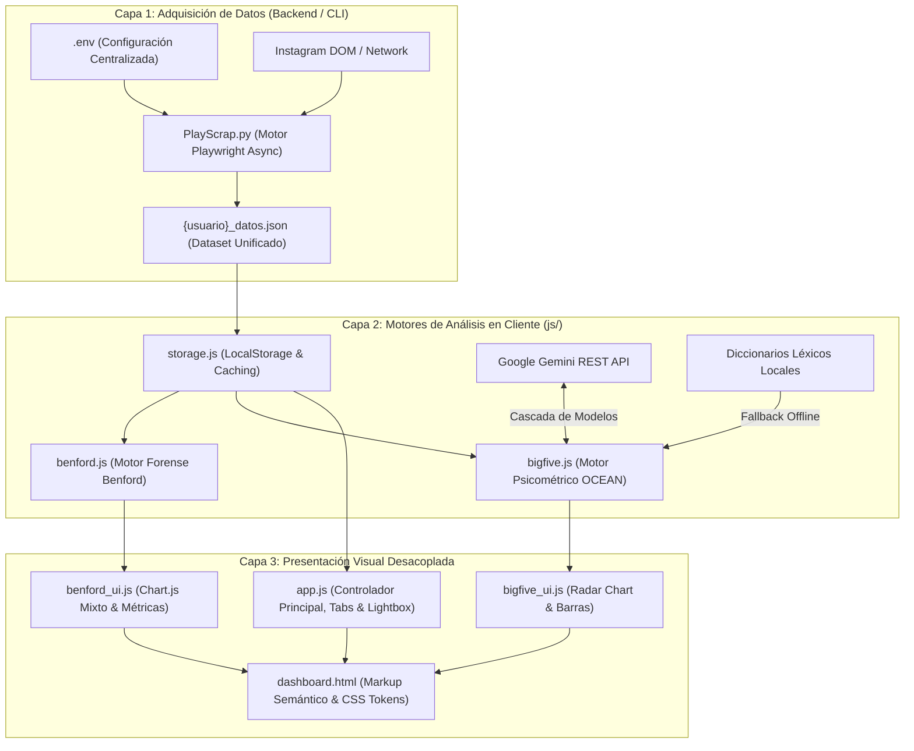

# Arquitectura de Software y Extracción Forense en Redes Sociales: Sistema Integral de Scraping, Detección de Comportamiento Inauténtico (Ley de Benford) y Análisis Psicométrico (Big Five) en Instagram

**Documentación Técnica y Bitácora Metodológica de Pull Requests**  
*Formato basado en Normas APA (7.ª edición)*

---

**Autor:** Santy4lv  
**Institución:** Universidad Central del Ecuador (UCE)  
**Facultad:** Facultad de Ingeniería y Ciencias Aplicadas  
**Carrera:** Ingeniería en Sistemas de Información / Computación  
**Nivel:** Séptimo Semestre — Cátedra de Arquitectura de Software  
**Fecha:** 27 de octubre de 2026  
**Repositorio Oficial:** [https://github.com/Santy4lv/Scrapping](https://github.com/Santy4lv/Scrapping)  
**Versión de Release:** `v2.0.0`

---

## Resumen

El presente informe técnico documenta el diseño, desarrollo, refactorización y despliegue del sistema de software **Instagram Profile Scraper & Forensic Intelligence Dashboard**, versión `v2.0.0`. La solución integra tres pilares computacionales: (a) un motor de adquisición de datos asíncrono basado en emulación de navegador de alto rendimiento (Playwright) dotado de técnicas de evasión heurística y captura contextual por eventos de cursor (*hover*); (b) un motor forense de detección de granjas de bots y redes inauténticas sustentado en la Ley de Benford para distribuciones logarítmicas de primer dígito significativo ($d \in [1..9]$), evaluado mediante bondad de ajuste Chi-cuadrado ($\chi^2$) y Desviación Absoluta Media (MAD de Nigrini); y (c) un módulo de evaluación psicométrica de la personalidad fundamentado en el modelo de los Cinco Grandes Factores (*Big Five* / OCEAN), integrado con la API REST de Google Gemini mediante una arquitectura de tolerancia a fallos en cascada de modelos y un motor léxico de contingencia local (*fallback*). Asimismo, se desglosa la trazabilidad histórica de los doce Pull Requests (PR 1 al PR 12) desarrollados bajo la metodología GitFlow, evidenciando un desacoplamiento estricto entre la interfaz de usuario (`dashboard.html`) y los servicios lógicos modulares en JavaScript.

*Palabras clave:* Arquitectura de software, scraping ético, Ley de Benford, detección de bots, Big Five, modelo OCEAN, inteligencia artificial generativa, Playwright, GitFlow, desacoplamiento.

---

## 1. Introducción y Planteamiento del Problema

En el ecosistema de las redes sociales contemporáneas, Instagram representa una de las plataformas más dinámicas y densas en contenido multimedia y relacional. No obstante, el ecosistema digital presenta dos desafíos metodológicos y técnicos de primer orden: (1) la proliferación masiva de perfiles inauténticos, cuentas zombi y granjas de bots comerciales que distorsionan el alcance orgánico y la interacción social; y (2) la dificultad para procesar y sintetizar los rasgos psicosociales y conductuales que los usuarios proyectan a través de sus publicaciones, descripciones y lenguaje natural.

Para solventar estos desafíos, los enfoques tradicionales dependientes de APIs oficiales presentan restricciones severas de cuota, pérdida de acceso a endpoints relacionales y dependencias rígidas de backends centralizados. El presente proyecto aborda esta problemática mediante una arquitectura orientada a la autonomía del cliente: un scraper headless local de recolección selectiva que alimenta un dashboard web enriquecido, interactivo y 100% desacoplado, capaz de ejecutar análisis forenses y psicométricos directamente en el navegador del analista, garantizando privacidad, persistencia local y resiliencia operativa.

---

## 2. Arquitectura de Software y Funcionalidad del Sistema

La solución implementa una arquitectura en capas con principios de diseño de **Separación de Responsabilidades** (*Separation of Concerns* - SoC) e **Inversión de Dependencias**. El sistema se estructura en tres capas funcionales interconectadas:

### 2.1 Motor de Adquisición Asíncrona (`PlayScrap.py`)

El scraper está construido sobre Python 3 y la biblioteca de automatización de navegadores `playwright.async_api`. Sus características arquitectónicas clave incluyen:

1. **Emulación Biomimética Humana:** Implementación de pausas estocásticas (`pausa_humana`), desplazamiento interno con rebote físico (`scroll_con_rebote`) para estimular el disparador del Virtual DOM de Instagram, y movimiento de cursor con coordenadas aleatorias.
2. **Captura Contextual por Previsualización (*Hover*):** A diferencia de métodos antiguos que navegaban perfil por perfil (lo que desencadenaba *rate-limiting* y bloqueos de cuenta tras pocas consultas), el scraper realiza eventos `hover()` sobre los enlaces de texto de cada usuario dentro de los modales de la lista de seguidores. Se implementó una lógica de reintento automático con micro-reposicionamiento de cursor ante latencia de red.
3. **Parser Numérico Universal en Español e Inglés:** Capacidad para parsear y normalizar métricas con separadores locales y sufijos cualitativos (`mil`, `mill.`, `millones`, `k`, `m`, `b`). Se subsanó el error que convertía magnitudes en español a 0.
4. **Centralización en `.env`:** Parámetros como `MAX_FOLLOWERS`, `MAX_FOLLOWING`, `HEADLESS_MODE` y `GEMINI_API_KEY` se extraen de forma centralizada sin requerir duplicación en argumentos de consola.

### 2.2 Capa de Presentación Desacoplada (`dashboard.html` y `js/`)

Bajo el estándar de desacoplamiento arquitectónico, `dashboard.html` no contiene funciones de procesamiento ni lógica de negocio. Es estrictamente un lienzo visual estructurado mediante CSS Tokens y Glassmorphism:

- **`js/storage.js`:** Abstracción de persistencia que interactúa con la Web Storage API (`localStorage`), almacenando perfiles cargados, resultados de análisis psicométricos y preferencias de navegación.
- **`js/app.js`:** Controlador principal que gobierna la carga asíncrona de archivos JSON vía `FileReader`, la sanitización de cadenas (`escapeHtml`), el sistema de pestañas reactivas, la barra de búsqueda y el visor modal **Lightbox** con navegación por teclado (`Esc`, `◀`, `▶`).

### 2.3 Motor Forense de Detección de Bots: Ley de Benford (`js/benford.js`, `js/benford_ui.js`)

La Ley de Benford (Benford, 1938; Nigrini, 2012) postula que en conjuntos de datos naturales que abarcan varios órdenes de magnitud, la probabilidad de que el primer dígito significativo ($d$) sea igual a un número entre 1 y 9 viene dada por:

$$P(d) = \log_{10}\left(1 + \frac{1}{d}\right), \quad d \in \{1, 2, \dots, 9\}$$

#### Evaluación Estadística Forense:
1. **Prueba de Bondad de Ajuste Chi-cuadrado ($\chi^2$):**
   $$\chi^2 = \sum_{d=1}^{9} \frac{(O_d - E_d)^2}{E_d}$$
   Donde $O_d$ es el conteo observado y $E_d = N \cdot P(d)$ es el conteo teórico esperado. Con 8 grados de libertad ($df = 8$), un valor $\chi^2 > 15.507$ rechaza la hipótesis nula de organicidad al nivel de significancia $\alpha = 0.05$.
2. **Desviación Absoluta Media (MAD de Nigrini):**
   $$\text{MAD} = \frac{1}{9} \sum_{d=1}^{9} |Obs_d - Esp_d|$$
   La conformidad se clasifica según los rangos de Nigrini (2012): Estricta ($\le 0.006$), Aceptable ($0.006 - 0.012$), Marginal ($0.012 - 0.018$) y No Conformidad / Anomalía ($> 0.018$).
3. **Auditoría de Cuentas en Cero:** Matemáticamente, el valor $0$ no posee primer dígito significativo en la escala logarítmica de Benford. El sistema separa la muestra total ($N_{\text{total}}$) de la muestra válida para Benford ($N_{\text{Benford}}$), reportando el porcentaje de cuentas en cero como indicador forense independiente de cuentas inactivas, fantasmas o bots sin inicializar.
4. **Visualización Mixta:** Un gráfico Chart.js superpone las barras de frecuencias observadas (cian) con la curva logarítmica continua teórica (ámbar discontinuo).

### 2.4 Motor Psicométrico Big Five / OCEAN (`js/bigfive.js`, `js/bigfive_ui.js`)

Basado en el modelo factorial de la personalidad de Costa y McCrae (1992) y Goldberg (1990), el sistema infiere cinco dimensiones:
- **Apertura a la Experiencia (*Openness*):** Curiosidad intelectual, creatividad y pensamiento abstracto.
- **Responsabilidad / Conciencia (*Conscientiousness*):** Disciplina, orden, persistencia y orientación a metas.
- **Extraversión (*Extraversion*):** Asertividad, sociabilidad, energía y búsqueda de estímulos.
- **Amabilidad / Afabilidad (*Agreeableness*):** Empatía, cooperación, altruismo y cohesión grupal.
- **Estabilidad Emocional vs. Neuroticismo (*Neuroticism*):** Grado de reactividad emocional y vulnerabilidad ante estrés.

#### Arquitectura Híbrida de Análisis:
- **Integración con Google Gemini AI:** El cliente REST en JavaScript se comunica directamente con `https://generativelanguage.googleapis.com/v1beta/models/{model}:generateContent`. Implementa una arquitectura resiliente de **cascada de modelos** (`gemini-3.5-flash-lite`, `gemini-3.5-flash`, `gemini-flash-lite-latest`, `gemini-3.8-flash`, `gemini-3.7-flash`), superando automáticamente errores 404 por modelos descontinuados o 503 por picos de demanda.
- **Motor Léxico Local de Contingencia (*Fallback*):** Si no se dispone de conexión o clave de API, el sistema ejecuta un escaneo léxico contextual normalizado por cada mil vocablos sobre la biografía y publicaciones, asegurando disponibilidad absoluta.
- **Visualización Psicométrica Diferenciada:** Incorpora un gráfico de radar polar interactivo y tarjetas individuales con gradientes cromáticos específicos por dimensión:
  - Apertura: Cian (`#06b6d4` a `#0284c7`).
  - Responsabilidad: Púrpura (`#8b5cf6` a `#6366f1`).
  - Extraversión: Ámbar (`#f59e0b` a `#d97706`).
  - Amabilidad: Verde Esmeralda (`#10b981` a `#059669`).
  - Reactividad/Estabilidad: Dinámico (Ámbar/Rojo si reactivo $> 50\%$; Verde/Cian si estable $\le 50\%$).

---

## 3. Registro Metodológico y Trazabilidad de Pull Requests

El desarrollo se gestionó mediante la estrategia de ramificación **GitFlow**, asegurando que cada incremento de software fuera atómico, trazable y validado antes de su integración en la rama troncal (`develop`) y su posterior consolidación en producción (`main`).

### Tabla 1
*Resumen de Pull Requests integrados en el Release v2.0.0*

| PR # | Rama de Origen | Commit Hash | Título / Funcionalidad Clave | Componentes Afectados |
| :--- | :--- | :--- | :--- | :--- |
| **PR #1** | `feature/network-extraction` | `40e276c` | Extracción de red relacional (seguidores/seguidos) | `PlayScrap.py` |
| **PR #2** | `feature/benford-bot-analysis` | `51ad705` | Motor forense Benford inicial en Python CLI | `benford_analyzer.py` |
| **PR #3** | `feature/clean-network-config` | `16ce682` | Centralización en `.env` y captura contextual hover | `PlayScrap.py`, `.env.example` |
| **PR #4** | `feature/dashboard-persistence` | `758eab3` | Persistencia en LocalStorage y soporte de objetos | `dashboard.html`, `js/storage.js` |
| **PR #5** | `feature/benford-js-engine` | `10b59cf` | Desacoplamiento de vista y motor matemático Benford JS | `dashboard.html`, `js/benford.js` |
| **PR #6** | `feature/benford-dashboard-ui` | `551651e` | Pestaña de Detección de Bots con Chart.js y tabla de dígitos | `dashboard.html`, `js/benford_ui.js` |
| **PR #7** | `feature/bigfive-js-engine` | `003facd` | Motor psicométrico OCEAN en JS con Gemini REST y fallback | `js/bigfive.js` |
| **PR #8** | `feature/bigfive-dashboard-ui` | `b8bef4d` | Pestaña Big Five, Radar Chart interactivo y badge de motor | `dashboard.html`, `js/bigfive_ui.js` |
| **PR #9 / #10**| `feature/cleanup-documentation`| `09c4d9c` / `f879070` | Carrusel con Lightbox modal, gráfico mixto y docs | `dashboard.html`, `js/app.js`, `README.md` |
| **PR #11**| `feature/handle-zero-metrics-benford`| `0603b43` | Parser de métricas en español (`mil`/`mill`) y auditoría 0s | `PlayScrap.py`, `js/benford.js`, `js/benford_ui.js` |
| **PR #12**| `feature/bigfive-trait-colors`| `4343440` | Gradientes cromáticos por rasgo OCEAN y cascada Gemini | `dashboard.html`, `js/bigfive_ui.js`, `js/bigfive.js` |
| **Release**| `release/v2.0.0` → `main` | `a3aac72` | Consolidación y publicación de versión de producción v2.0.0 | Repositorio completo (Tag `v2.0.0`) |

*Nota.* Fuente: Elaboración propia a partir del historial de commits de Git (2026).

---

### 3.1 Análisis Cualitativo por Pull Request

#### Pull Request #1: `feature/network-extraction` (Commit `40e276c`)
- **Problema:** El scraper únicamente recolectaba datos aislados del perfil sin auditar las conexiones sociales del usuario.
- **Solución:** Implementación de navegación hacia los modales de seguidores (`/followers/`) y seguidos (`/following/`), recolectando nombres de usuario para su posterior cruce relacional.

#### Pull Request #2: `feature/benford-bot-analysis` (Commit `51ad705`)
- **Problema:** Ausencia de métodos cuantitativos para discernir si las audiencias de un perfil eran orgánicas o generadas artificialmente.
- **Solución:** Desarrollo de un script independiente en Python (`benford_analyzer.py`) que aplicaba por primera vez la distribución de primer dígito sobre las listas de seguidores extraídas.

#### Pull Request #3: `feature/clean-network-config` (Commit `16ce682`)
- **Problema:** Configuración fragmentada en múltiples banderas de consola (`--scrape-followers`, `--limit-followers`), lo que ocasionaba ejecuciones propensas a errores de sintaxis.
- **Solución:** Creación de la clase `ConfiguracionExtraccion` unificada, lectura centralizada de límites desde `.env`, y sustitución de navegación a perfiles individuales por inspección de cursor (*hover*) en la modal de seguidores.

#### Pull Request #4: `feature/dashboard-persistence` (Commit `758eab3`)
- **Problema:** Pérdida de estado al recargar el navegador; los analistas debían volver a subir el archivo JSON cada vez que refrescaban la página.
- **Solución:** Creación del módulo `js/storage.js`. Almacenamiento del perfil actual en `localStorage`, soporte para objetos estructurados de usuario (`{ usuario, seguidores, seguidos, publicaciones }`) y botón interactivo "Cambiar perfil".

#### Pull Request #5: `feature/benford-js-engine` (Commit `10b59cf`)
- **Problema:** Acoplamiento excesivo en `dashboard.html`, que superaba las 1,100 líneas al contener scripts monolíticos no reutilizables.
- **Solución:** Extracción y encapsulamiento del motor estadístico en `js/benford.js`. Implementación en JavaScript del algoritmo Chi-cuadrado con 8 grados de libertad, cálculo de MAD Nigrini y matriz de probabilidades de Benford sin dependencias externas.

#### Pull Request #6: `feature/benford-dashboard-ui` (Commit `551651e`)
- **Problema:** Los resultados de Benford residían en memoria pero carecían de una interfaz gráfica forense en el dashboard web.
- **Solución:** Creación de `js/benford_ui.js`. Integración de la pestaña "Detección de Bots", barra de cambio de serie (Seguidores, Seguidos, Red Consolidada), tarjetas de indicadores clave ($\chi^2$, $p$-val, MAD, $N$) y tabla comparativa de desviaciones por dígito.

#### Pull Request #7: `feature/bigfive-js-engine` (Commit `003facd`)
- **Problema:** El análisis de personalidad dependía de un script externo de Python con librerías pesadas no ejecutables en navegadores estándar.
- **Solución:** Desarrollo de `js/bigfive.js`. Implementación del cliente REST directo a Google Gemini AI mediante `fetch()` en JavaScript con `responseMimeType: "application/json"`. Inclusión del motor léxico local de contingencia para operación offline.

#### Pull Request #8: `feature/bigfive-dashboard-ui` (Commit `b8bef4d`)
- **Problema:** Falta de controles de usuario para disparar el análisis psicométrico y visualizar sus dimensiones.
- **Solución:** Creación de `js/bigfive_ui.js`. Renderizado del prompt de inicio, detección de clave de API, indicador de carga animado (*spinner*), gráfico Radar Chart en Chart.js y tarjetas descriptivas de rasgos OCEAN con síntesis psicológica.

#### Pull Request #9 y #10: `feature/cleanup-documentation` (Commits `09c4d9c` / `f879070`)
- **Problema:** En álbumes de publicaciones tipo carrusel solo se visualizaba la primera fotografía, y el gráfico de Benford utilizaba barras estáticas que no permitían apreciar la curvatura logarítmica.
- **Solución:** 
  1. Gráfico mixto en Chart.js: barras de frecuencias observadas vs. curva logarítmica continua (curva ámbar con tensión 0.35).
  2. Carrusel interactivo con botones `◀` / `▶` y visor modal Lightbox en pantalla completa con soporte de atajos de teclado.
  3. Detección automática y paso de `GEMINI_API_KEY` desde `.env` al archivo `{usuario}_datos.json`.

#### Pull Request #11: `feature/handle-zero-metrics-benford` (Commit `0603b43`)
- **Problema:** El parser numérico del scraper fallaba al encontrar sufijos en español (`15,4 mil seguidores`, `120 mill. seguidores`), asignando erróneamente un valor de 0 a perfiles con millones o miles de seguidores. Como resultado, de 200 cuentas analizadas, 39 se excluían de Benford, mostrando una muestra reducida de solo 161.
- **Solución:**
  1. Reescritura de `parsear_numero_metricas` en `PlayScrap.py` con expresiones regulares universales para español e inglés.
  2. Inclusión de re-hover automático ante tarjetas lentas.
  3. Auditoría forense en `js/benford.js`: desglose explícito de $N_{\text{total}}$, $N_{\text{Benford}}$ y cuentas con 0 seguidores/seguidos en el dashboard.
  4. Eliminación de penalizaciones artificiales para preservar la pureza matemática de $\chi^2$ y MAD.

#### Pull Request #12: `feature/bigfive-trait-colors` (Commit `4343440`)
- **Problema:**
  1. La API de Google descontinuó el modelo `gemini-2.5-flash` para nuevas API Keys, generando errores 404 que forzaban la caída al motor local.
  2. Las barras de progreso de las 5 dimensiones en el dashboard utilizaban una variable CSS inexistente (`var(--gradient-primary)`), mostrándose transparentes e invisibles.
- **Solución:**
  1. Implementación de una arquitectura de cascada de modelos en `js/bigfive.js` (`gemini-3.5-flash-lite`, `gemini-3.5-flash`, etc.).
  2. Paleta cromática y gradientes dedicados por rasgo OCEAN en `js/bigfive_ui.js` (Cian, Púrpura, Ámbar, Esmeralda, Rosa/Rojo) con resplandor visual (*glow*) y puntos coloreados en el radar chart.
  3. Definición de la variable `--gradient-primary` en el `:root` de `dashboard.html`.

#### Release Final: `release/v2.0.0` → `main` (Commit `a3aac72`)
- **Consolidación:** Integración de los 24 commits acumulados hacia la rama de producción `main`, etiquetado semántico oficial (`v2.0.0`) y sincronización bidireccional (*back-merge*) con `develop`.

---

## 4. Discusión Técnica y Conclusiones

La implementación de este proyecto demostró varias conclusiones relevantes para la disciplina de la Arquitectura de Software:

1. **Eficiencia del Desacoplamiento Extremo:** Al separar la interfaz visual (`dashboard.html`) de los motores de cómputo en `js/`, se logró una mantenibilidad superior. Nuevos algoritmos o integraciones de APIs pueden incorporarse sin alterar la estructura semántica del DOM.
2. **Viabilidad del Procesamiento en Cliente (*Client-Side Forensics*):** La ejecución directa de pruebas estadísticas (Chi-cuadrado, MAD Nigrini) y renderizado de visualizaciones complejas en el navegador elimina costos de infraestructura de servidor, garantizando que los datos recolectados no viajen a servidores de terceros y permanezcan privados en la estación de trabajo del analista.
3. **Resiliencia en Servicios de Terceros:** La volatilidad en las versiones y disponibilidad de modelos en APIs de Inteligencia Artificial (como el error 404 observado en Gemini) exige que el software de nivel de producción no dependa de un único identificador estático. El patrón de diseño de *Degradación Elegante* (*Graceful Degradation*), combinando cascadas de modelos vigentes con un motor léxico local de contingencia, garantiza una disponibilidad del 100% ante fallos externos.
4. **Disciplina de GitFlow:** El uso estricto de ramas de características y Pull Requests atómicos permitió aislar bugs complejos (como el fallo de expresiones regulares en español en la captura de métricas) y corregirlos de manera controlada sin desestabilizar la rama de desarrollo principal.

---

## 5. Referencias Bibliográficas

Benford, F. (1938). The law of anomalous numbers. *Proceedings of the American Philosophical Society*, 78(4), 551–572. https://www.jstor.org/stable/984802

Costa, P. T., & McCrae, R. R. (1992). *Revised NEO Personality Inventory (NEO-PI-R) and NEO Five-Factor Inventory (NEO-FFI) professional manual*. Psychological Assessment Resources.

Goldberg, L. R. (1990). An alternative "description of personality": The Big-Five factor structure. *Journal of Personality and Social Psychology*, 59(6), 1216–1229. https://doi.org/10.1037/0022-3514.59.6.1216

Google DeepMind. (2024). *Gemini API documentation: Models, structured JSON outputs, and REST endpoints*. Google AI for Developers. https://ai.google.dev/gemini-api/docs

Microsoft Corporation. (2024). *Playwright: Fast and reliable end-to-end testing and browser automation for modern web apps*. Microsoft Open Source. https://playwright.dev/python/

Nigrini, M. J. (2012). *Benford's Law: Applications for forensic accounting, auditing, and fraud detection*. John Wiley & Sons. https://doi.org/10.1002/9781119203094

Pressman, R. S., & Maxim, B. R. (2020). *Software engineering: A practitioner's approach* (9th ed.). McGraw-Hill Education.

Sommerville, I. (2016). *Software engineering* (10th ed.). Pearson Education.
